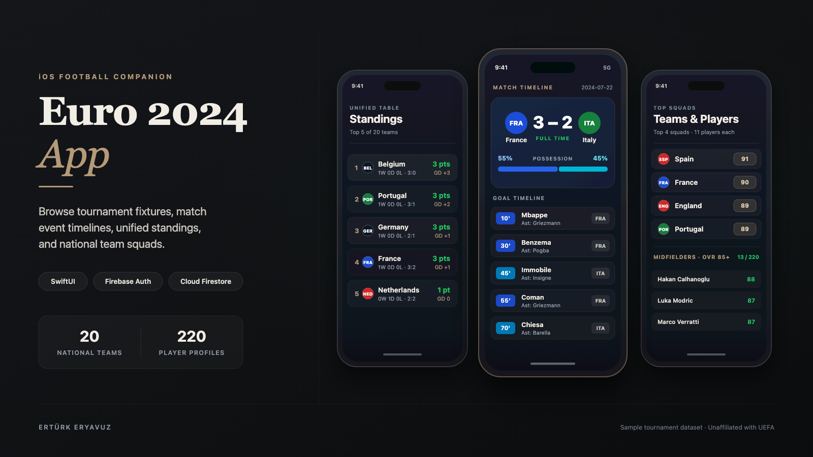

# Euro2024App

[](https://erturkeryavuz.github.io/euro2024app-demo/)

**Live Interactive Demo:** [https://erturkeryavuz.github.io/euro2024app-demo/](https://erturkeryavuz.github.io/euro2024app-demo/)

Euro2024App is an iOS football companion built with **SwiftUI** and **Firebase** for exploring European tournament fixtures, chronological match event timelines, dynamically calculated standings, national team rosters, and a filterable 220-player directory.

The live GitHub Pages site provides an interactive browser preview of the mobile interface alongside a technical inspector mapping each screen to its corresponding SwiftUI view, data model, and Firestore operation.

## Core Features

- **Fixtures & Match Timelines:** Browse tournament fixtures and drill into individual matches to inspect possession breakdowns and chronologically sorted goal and assist events.
- **Unified Standings Table:** Computes points (3 for a win, 1 for a draw, 0 for a loss), win-draw-loss records, and goal difference dynamically across all 20 national teams.
- **National Teams & Squad Drill-Down:** Explore national teams with squad ratings and custom geometric monogram badges, then open any team to view its 11-player roster.
- **Player Directory & Multi-Criteria Filtering:** Filter 220 footballer profiles simultaneously by position, nationality, and minimum overall rating.
- **News & User Profile:** Includes a lightweight news feed view and an authenticated profile screen for managing favorite team, player, and match preferences.

## Technology Stack

- **Original iOS Application:** SwiftUI (`iOS 17.5`, Swift Package Manager), Firebase Authentication, and Cloud Firestore
- **Data Pipeline:** Python Firestore seeding scripts (`euro2024_matches.py` and structured JSON collections for matches, events, teams, and players)
- **Browser Preview:** Vanilla HTML, CSS, and ES Modules (`docs/`) with zero external runtime dependencies

## Architecture & Engineering Notes

- **ViewModel-Driven SwiftUI Structure:** Separates match feeds (`MatchViewModel`), standings calculation (`LeagueStandingViewModel`), squad directories (`TeamViewModel`), player filtering (`PlayerViewModel`), and news (`NewsViewModel`).
- **Normalized Position Filtering:** Unifies `"Center Midfielder"` and `"Central Midfielder"` dataset labels inside `PlayerListView` so every player in the 220-player dataset is reachable through position filters.
- **Authentication & Storage Hardening:** Avoids storing plaintext passwords in `UserDefaults` (`@AppStorage("userPassword")` removed), clears cached user keys on sign-out, and defers Firestore email updates until email verification completes.

## Exploring the Browser Preview

- **Direct Mobile Navigation:** Interact directly with the iOS phone frame or jump between views using the quick-navigation bar above the workspace.
- **Watch Tutorial:** Launch the optional 9-stage guided walkthrough with play/pause, previous/next stepping, restart, responsive viewport fitting, and reduced-motion support.
- **Technical Inspector:** Switch between **Live Data Trace**, **Dataset & Provenance**, and **Architecture & Security** to examine the SwiftUI view mapping, simulated Firestore payloads, and dataset schema behind each interaction.

## Data Provenance & Preview Scope

- **Source Availability:** The original SwiftUI Xcode project and Python Firestore seeding pipeline reside in a private repository. This public repository contains the standalone static browser preview (`docs/`), media attribution notices, and offline verification checks.
- **Offline Simulation:** The browser preview runs entirely client-side over bundled data with no live Firebase connection, no real user accounts, no credentials, and no external network requests.
- **Sample Dataset:** Built on the project's bundled `euro2024_data/*.json` sample dataset — 20 national teams (including Sweden, Russia, and Wales), 220 Euro 2020/2021-era player profiles, 5 synthetic demonstration matches dated `2024-07-22` through `2024-07-26` (19 goal events), and 2 static placeholder news items. It is preserved as the project's original dataset and is **not** live or official UEFA Euro 2024 tournament data.
- **Affiliation:** Euro2024App is an independent, unmonetized portfolio project by **Ertürk Eryavuz** and is not affiliated with, endorsed by, or sponsored by UEFA, any national football federation, any club, or any athlete.

## Media Licensing & Attribution

All 74 visual assets in `docs/assets/` are either original vector graphics created for this project (25 SVGs: 20 geometric team monogram badges, 4 navigation icons, and 1 neon mesh backdrop) or cropped/resized derivatives of openly licensed Wikimedia Commons photographs (49 JPEGs under `CC BY`, `CC BY-SA`, or `CC0`). No watermarked stock media or official federation crests are included.

Repository cover artwork in `media/` and editable vector sources in `media/src/` (`euro2024app-readme-hero` and `euro2024app-social-preview`) are original vector graphics authored for this repository.

- Full attribution table: [docs/THIRD-PARTY-NOTICES.md](docs/THIRD-PARTY-NOTICES.md)
- Live notices page: [https://erturkeryavuz.github.io/euro2024app-demo/notices.html](https://erturkeryavuz.github.io/euro2024app-demo/notices.html)

## Local Preview & Verification

```bash
# Run offline safety, asset, and tutorial verification suites
python3 tests/verify_demo.py
python3 -m unittest discover -s tests -v

# Serve the static preview locally
python3 -m http.server 8080 --directory docs
# Open http://127.0.0.1:8080/
```
